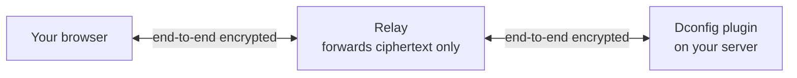

<div align="center">


# Dconfig

**Edit your server's configs in a browser. See them the way players do.**


[Website](https://dconfig.in) &nbsp;·&nbsp; [Report a bug](../../issues/new?template=bug_report.yml) &nbsp;·&nbsp; [Request a feature](../../issues/new?template=feature_request.yml) &nbsp;·&nbsp; [All issues](../../issues)

</div>

<br>

Dconfig is a Paper plugin and a web panel. Change any plugin's `.yml` files from a browser instead of an SSH window, and watch MOTDs, chat formats, tab lists and scoreboards update as players will see them, **before** anything is saved.

This repository is the public home of Dconfig's **issue tracker**: bugs, feature requests and questions.

<br>

## Highlights

|  |  |
|---|---|
| **See it first** | Live previews of MiniMessage text, `&` codes and gradients, drawn from your unsaved draft. |
| **Safe by default** | Every save is checked, backed up and written in one step. Earlier versions are one click away. |
| **Made for teams** | Owner, manager and viewer roles, limited to the plugins you choose. Secrets stay masked. |
| **Private** | Your configs are end-to-end encrypted. The panel's relay cannot read them. |
| **Plain-English YAML** | Errors are marked as you type, with one-click fixes. Save is off while there are errors. |
| **Nothing to open** | The plugin connects out to the panel. No port forwarding. |

<br>

## How it works



The plugin opens one outgoing connection to the panel. Your browser and the plugin agree on a key between themselves, and the relay only passes encrypted messages along. You confirm the server's fingerprint once, like an SSH host key, and your browser warns if it ever changes.

<details>
<summary><b>Exactly what leaves your server</b></summary>

<br>

Dconfig does nothing on the network until you paste a key into `web.yml`. After that it keeps one outgoing WebSocket open to the address in that file. There is no telemetry, no update check, no download and no code loaded from anywhere.

- The panel is told the server key, the plugin's public identity key, the Dconfig and game versions, and who is signed in with which role. Like any web service it also sees connection details such as your server's IP address.
- Only `.yml` files inside the plugin folders you list in `web.yml` can be opened. Never data folders, and never Dconfig's own key or identity file.
- To turn it off, empty the `key:` line in `web.yml`.

</details>

<br>

## Quick start

1. Put `Dconfig.jar` in your `plugins` folder and start the server once.
2. Open [dconfig.in](https://dconfig.in), sign in, press **Link a server** and copy the key. It is shown once.
3. In `plugins/Dconfig/web.yml`, paste the key, set `url:` to the address the panel shows, and list the plugins to share:

   ```yaml
   url: "wss://dconfig.in/ws/plugin"
   key: "dcw_..."
   plugins:
     - Dcore
     - Dtab
   ```

4. Run `/dconfig web reload`.
5. The panel shows a short code. Compare it with `/dconfig web identity` and confirm it once.

Stuck? `/dconfig web help` prints these steps in game or in the console.

<br>

## Commands

| Command | What it does |
|---|---|
| `/dconfig` &nbsp;(`/dcfg`, `/configui`) | Opens the in-game editor |
| `/dconfig <plugin>` | Opens one plugin's settings |
| `/dconfig reload` | Reloads Dconfig's own settings |
| `/dconfig web help` | Panel address and setup steps |
| `/dconfig web status` | Connection state and the last problem, if any |
| `/dconfig web reload` | Re-reads `web.yml` and reconnects |
| `/dconfig web identity` | This server's fingerprint, to compare with the panel |

Permission: `dconfig.admin` (default: operators).

<br>

## Compatibility

| | |
|---|---|
| Server | **Paper 26.2** (not tested on Spigot, Folia or other forks) |
| Java | **25** |
| In-game editor | Java Edition. Bedrock players can use the web panel. |
| Support | The **latest release** only. Please update before reporting. |

<br>

## Support

**Found a bug?** [Open a bug report](../../issues/new?template=bug_report.yml). **Missing something?** [Request a feature](../../issues/new?template=feature_request.yml). Please search the [existing issues](../../issues) first, and add details there if your problem is already reported.

<details>
<summary><b>What makes a good bug report</b></summary>

<br>

1. **Dconfig version:** the output of `/version Dconfig`.
2. **Server:** the output of `/version`, and your Java version.
3. **What you did, what you expected, what happened.** Numbered steps are best.
4. **Connection problems:** the output of `/dconfig web status`, and the server log lines that mention Dconfig.
5. **Panel problems:** your browser and its version, and a screenshot if it is visual.
6. **A file that saved wrongly:** the plugin and file name, and the lines that changed. A "before" and "after" is enough, not the whole file.

</details>

> [!WARNING]
> **Never post your key.** Do not paste `plugins/Dconfig/web.yml`, `identity.key`, or any line starting with `key:` or `dcw_`. Remove passwords, tokens and database URLs from logs and configs too. The fingerprint from `/dconfig web identity` is safe to share.

> [!IMPORTANT]
> **Security problems are not public issues.** If you can read another server's files, bypass a role, or similar, use **Security → Report a vulnerability** on this repository to tell me privately.

I read every issue. There is no guaranteed reply time. Issues are labelled `bug`, `enhancement`, `question` or `needs info`; a `needs info` issue with no answer for 30 days may be closed, and you can reopen it with the details.

<br>

## Made with AI help

Dconfig was designed and directed by its author, with a large part of the code written with the help of an AI assistant (Claude by Anthropic), then tested and reviewed on a live server.

<br>

## License

**Copyright © 2026 Dconfig. All Rights Reserved.**

Dconfig is proprietary software. You may download the official release and run it on servers you own or administer, and you may post issues here. You may not copy, modify, redistribute, re-upload or sell Dconfig or any part of it, or use its name or logo, without written permission. See [LICENSE](LICENSE) for the full notice.

<br>

<div align="center">
<sub>Dconfig is an independent project and is not affiliated with Mojang, Microsoft or PaperMC.</sub>
</div>
